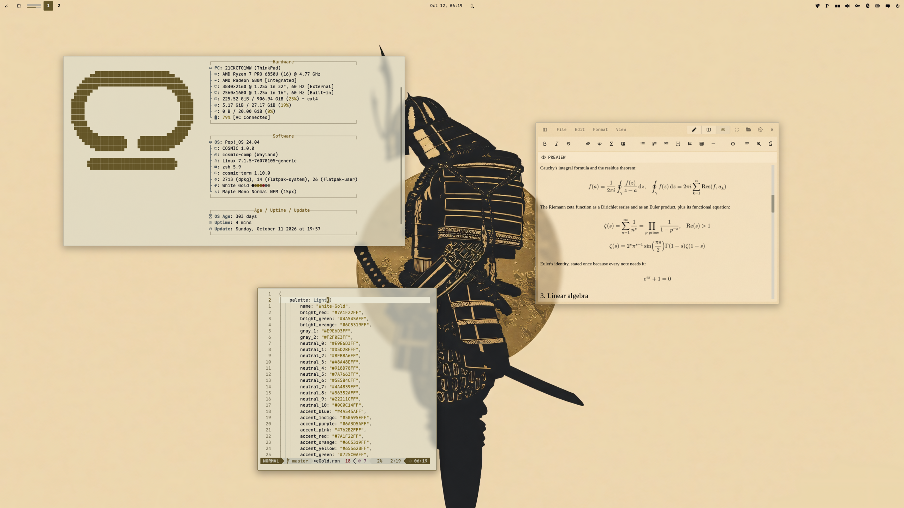
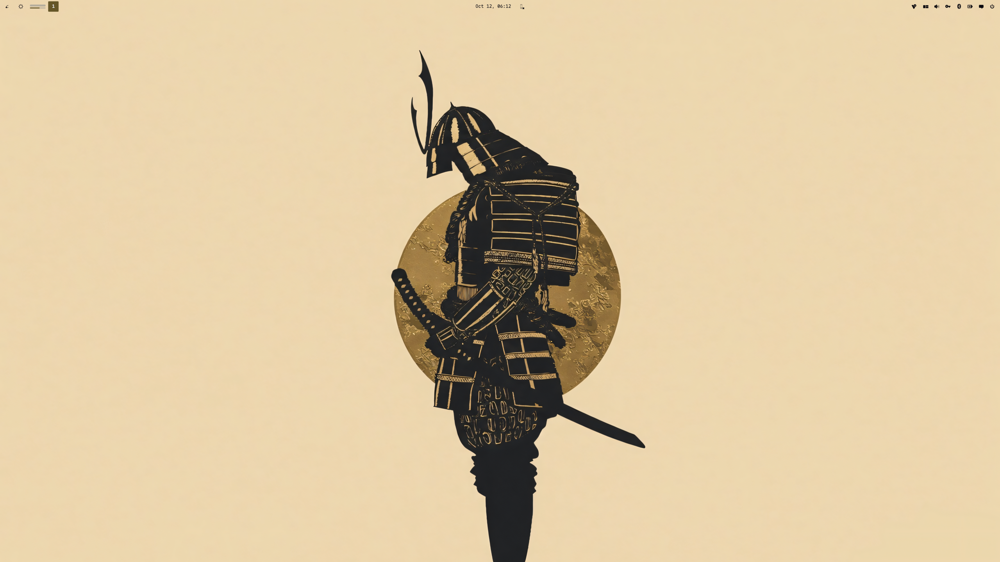

<div align="center">

# COSMIC · White Gold

Pop!_OS 24.04 on COSMIC in parchment and dark gold: desktop, terminal, shell,
Firefox, cursor, wallpapers. The light sibling of
[cosmic-darkgold-theme](https://github.com/atraxsrc/cosmic-darkgold-theme).


</div>

---


## Palette

Parchment and ink from the Omarchy
[White Gold](https://github.com/HANCORE-linux/omarchy-whitegold-theme) theme,
with the accent moved from green to the dark gold of DarkGold's light mode so
the two rices read as one family. Every text colour is at least 4.5:1 on the
window background.

| Role | Color | Hex |
|------|-------|-----|
| Background |  Parchment | `#DEDBC8` |
| Containers |  Linen / Ivory | `#E9E6D3` / `#F2F0E3` |
| Text |  Ink | `#0C0C14` |
| Accent |  Dark gold | `#655628` |
| Success |  Olive gold | `#725C0A` |
| Warning |  Bronze | `#6C5319` |
| Error |  Wine | `#7A1F22` |
| Slate |  Directories, links | `#4A545A` |
| Plum |  Symlinks | `#6A3D5A` |
| Muted |  Secondary text | `#665E4A` |
| Dim |  Comments | `#7A7259` |
| Sand |  Borders, box lines | `#9A9078` |

| Role | DarkGold | White Gold |
|------|----------|------------|
| Background | `#1B1B1B` | `#DEDBC8` |
| Text | `#EFEBDC` | `#0C0C14` |
| Accent | `#C0AF7F` | `#655628` |
| Slate | `#77838A` | `#4A545A` |

---

## Repo Structure

```
.
├── backgrounds/                 # wallpapers, whitegold-<subject>.png (see Icons and wallpaper)
├── btop
│   └── WhiteGold.theme          # btop colour theme
├── claude-desktop
│   ├── cosmic-darkgold.jsonc    # Claude Desktop theme (claude-desktop-extra), dark + light
│   └── install.sh
├── cosmic
│   ├── WhiteGold.ron            # COSMIC Appearance import (Light)
│   ├── config/                  # baseline settings: fonts, icons, terminal look
│   └── install.sh
├── cosmic-term
│   └── WhiteGold-term.ron       # COSMIC Terminal colour scheme (Light)
├── cursors
│   ├── Oxygen-WhiteGold-*/       # cursor themes, one per icon colour, patched for COSMIC apps
│   ├── install.sh
│   ├── uninstall.sh
│   └── README.md
├── icons
│   └── install.sh               # Cosmic-WhiteGold icon pack from cosmic-icon-themes
├── fastfetch
│   ├── config.jsonc             # gold / slate fastfetch config
│   ├── cosmic.txt               # COSMIC logo
│   └── install.sh
├── firefox
│   ├── theme                    # Cosmic White Gold theme add-on (manifest + icons)
│   ├── chrome
│   │   ├── userChrome.css       # rounded chrome, parchment menus, gold hover
│   │   └── userContent.css      # new tab accents, blank tiles
│   ├── install.sh
│   └── README.md
├── lsd
│   ├── config.yaml              # theme: custom
│   ├── colors.yaml              # permission / size / date / git columns
│   └── install.sh
├── nvim                         # Neovim colorscheme, LazyVim spec, RON syntax, install.sh
├── telegram
│   ├── colors.tdesktop-theme    # Telegram Desktop colour scheme (source)
│   ├── cosmic-whitegold.tdesktop-theme  # built theme, open this in Telegram
│   └── build.sh                 # rebuilds it, optionally with a wallpaper
├── scripts
│   ├── update_system.sh         # nala + flatpak, dark ANSI for a light terminal
│   └── switch.sh                # make this the active rice (see Switching rice)
├── zsh
│   ├── whitegold.zsh            # LS_COLORS, highlighting colours, aliases, starship
│   └── install.sh
├── assets
│   ├── cursors/                 # cursor preview
│   ├── screenshot.png           # README screenshot
│   └── wallpaper.png            # the samurai on the bare desktop
├── docs
│   └── showcase.md              # the rice describing itself, for the Postilla pane of the screenshot
├── LICENSE
└── README.md
```

---

## COSMIC Desktop

This is a **Light** theme, so it goes in COSMIC's Light slot:

Settings → Desktop → Appearance → **Light** → **Import** → `cosmic/WhiteGold.ron`

Accent is dark gold `#655628`. Use the `+` control if you want a custom swatch.

Frosted glass is on in the `.ron` at `frosted: Low` with an opacity table of
0.66 to 0.96, tinted with the palette's middle neutral, for windows, panel,
applets and system UI (maximized apps stay solid), and corners are squared
(`radius_*: 2.0`), the same as the DarkGold baseline. Adjust frosted glass on
Appearance → Style → Frosted glass after import; those sliders survive a theme switch.

Export from Appearance if you tweak backgrounds / tints so you do not lose them.

Pairing tip: import `DarkGold.ron` from
[cosmic-darkgold-theme](https://github.com/atraxsrc/cosmic-darkgold-theme)
into the Dark slot and COSMIC's Dark / Light toggle flips between the two.
Wallpaper, Firefox and the shell layer do not follow the toggle; those are
per-rice files, see below.

### Baseline settings

`cosmic/config/` holds the settings that make up the look and rarely change
(panel, dock, applets and shortcuts are left out on purpose):

| Where | Setting |
|-------|---------|
| Fonts | Interface `Maple Normal UI`, monospace `Maple Mono Normal NFM` |
| Icons | Cosmic-WhiteGold-Gold |
| Windows | Minimize / maximize buttons hidden, theme applied to GNOME apps |
| Terminal | Maple Mono 15 (weights 500 / bold 800 / dim 300), 77% opacity, no header bar, White Gold (light scheme) |

Install the [Maple fonts](https://github.com/subframe7536/maple-font) and the
Cosmic-WhiteGold icons (see Icons below) and import the terminal scheme first, then:

```bash
./cosmic/install.sh
```

It backs up each file it replaces to `*.bak` and COSMIC applies it live.

---

## COSMIC Terminal

The desktop `.ron` does not colour ANSI text.

1. COSMIC Terminal → **View → Color schemes…** (not Settings → Appearance)
2. **Light** tab → **Import** → `cosmic-term/WhiteGold-term.ron`
3. View → Settings → Appearance → Color scheme (light) → **White Gold**

If a profile is set as default, set the scheme on that profile too or the
dropdown will look like it did nothing.

Ink text on parchment; wine for errors, olive gold for strings and success,
slate for directories. Bright colours are deeper, dim colours lighter, so bold
and dim still read on a light background.

---

## Firefox

Two layers:

1. **Theme (colours):** install
   **[cosmic-whitegold-theme on addons.mozilla.org](https://addons.mozilla.org/en-US/firefox/addon/cosmic-whitegold-theme/)**.
   This is the main look.
2. **Stylesheets (optional):** `firefox/chrome/` adds rounded corners, gold
   menu hover, gold accents and blank new-tab tiles on top of the add-on
   (they also work with Firefox's built-in Light theme):

```bash
./firefox/install.sh
```

Fully quit Firefox afterward. Details and CSS rules: [`firefox/README.md`](firefox/README.md).

---

## Claude Desktop

For the unofficial [claude-desktop-extra](https://github.com/patrickjaja/claude-desktop-extra)
Linux build. `claude-desktop/cosmic-darkgold.jsonc` is one theme with both halves:
DarkGold in dark mode and White Gold in light mode, so Claude's own
Settings → Appearance toggle switches between the two rices.
Colours come from `cosmic/*.ron`, contrast-checked (text and button text
4.5:1, accents 3:1).

```bash
./claude-desktop/install.sh
```

It copies the file into `~/.config/Claude/themes.d/`. Then press
<kbd>Ctrl</kbd>+<kbd>Shift</kbd>+<kbd>T</kbd> in Claude Desktop and pick **cosmic-darkgold**.

The same file ships in [`cosmic-darkgold-theme`](https://github.com/atraxsrc/cosmic-darkgold-theme),
so installing from either repo gives the same theme.

---

## Telegram

`telegram/cosmic-whitegold.tdesktop-theme` is a Telegram Desktop theme:
parchment chat list and background, linen incoming and pale olive-gold
outgoing bubbles, dark gold for the accent, links, unread badges and buttons
(with parchment text on them), olive gold for online status and read ticks.
Group member names use the rice's terminal colours. Text and badge colours are
contrast-checked at 4.5:1 or better, except disabled menu items.

Settings → Chat Settings → Chat wallpaper → **Choose from file** →
`telegram/cosmic-whitegold.tdesktop-theme` → **Apply this theme**.

The colours live in `telegram/colors.tdesktop-theme`, which is plain text;
`build.sh` zips it with the chat background into the `.tdesktop-theme`. The
background is the plain window colour; to put a wallpaper behind the chat instead
(ImageMagick re-encodes it to a 2560px JPEG, Telegram caps theme files at 5 MB):

```bash
./telegram/build.sh --wallpaper backgrounds/whitegold-anime.png
```

Built against Telegram Desktop 7.3.1. Calls, group calls, statistics charts and
premium badges keep Telegram's own colours.

Telegram has no dark / light pairing, so DarkGold, the dark half, ships its own
theme.

---

## Cursor

**Oxygen** cursors recoloured to the icon colours, one per folder colour of the
Cosmic-WhiteGold icon pack: **Gold** (default), **Red**, **Slate**, **Ink**. Patched with the cursor
names COSMIC apps ask for. COSMIC has no cursor picker yet, so the script sets it:

```bash
./cursors/install.sh                      # Gold
./cursors/install.sh --variant Red       # or another, see --list
reboot
```

Previews, what the script touches, how to undo it and how the colours are made:
[`cursors/README.md`](cursors/README.md).

---

## Scripts

### `update_system.sh`

nala + flatpak updater. Headers in gold, info in slate, success in olive gold,
errors in wine; the banner ramps from brown to gold. All dark enough for a
light terminal.

```bash
chmod +x scripts/update_system.sh
./scripts/update_system.sh
```

### `switch.sh`

Makes this the active rice, coming from any other `cosmic-*-theme` rice. See
[Switching rice](#switching-rice).

```bash
./scripts/switch.sh
```

---

## Terminal extras

Need a [Nerd Font](https://www.nerdfonts.com/) in the terminal for the icons
(Maple Mono NFM in the baseline above).

### zsh

`zsh/whitegold.zsh` is the rice part of the shell only: `LS_COLORS` (also
used by lsd for file names and by the completion menu), dark gold / slate /
wine colours for zsh-autosuggestions and zsh-syntax-highlighting, lsd / bat /
nvim aliases and the starship prompt. Your own `~/.zshrc` stays private and
sources it.

Needs zsh + [oh-my-zsh](https://ohmyz.sh/). `install.sh` clones the two
plugins if missing and appends one `source` line to `~/.zshrc` (backup in
`~/.zshrc.bak`):

```bash
./zsh/install.sh
exec zsh
```

In `~/.zshrc` keep `ZSH_THEME=""` and
`plugins=(git sudo zsh-autosuggestions zsh-syntax-highlighting)`.

### lsd

File names are coloured by `LS_COLORS` from `zsh/whitegold.zsh`;
`lsd/colors.yaml` colours the other columns with the 256-colour codes nearest
the palette (58 olive gold, 94 bronze, 88 wine, 60 slate, 241 muted,
245 sand). lsd 1.0.0 does not accept `#hex` there.

```bash
./lsd/install.sh
lsd -l
```

### fastfetch

COSMIC logo in gold, Hardware / Software / Age boxes in sand with slate keys.
`install.sh` backs up any existing `~/.config/fastfetch/config.jsonc` to
`config.jsonc.bak`.

```bash
./fastfetch/install.sh
fastfetch
```

### Neovim

`nvim/` carries the rice into Neovim: a dependency-free colorscheme built from
the palette (`nvim/colors/whitegold.lua`), a LazyVim spec that selects it and makes
sure the treesitter parsers for the files in this repo are installed
(`nvim/lua/plugins/whitegold.lua`), and a small RON syntax file so `cosmic/*.ron`
is coloured even before the parser exists. `:terminal` inside Neovim uses the
White Gold scheme.

```bash
./nvim/install.sh
# restart nvim; LazyVim switches to the whitegold colorscheme
```

Without LazyVim, copy `nvim/colors/whitegold.lua` to `~/.config/nvim/colors/` and
run `:colorscheme whitegold`.

### btop

`btop/WhiteGold.theme`: parchment background, sand boxes, gold titles, meters
ramp from sand through bronze to wine.

```bash
mkdir -p ~/.config/btop/themes
cp btop/WhiteGold.theme ~/.config/btop/themes/
# btop → Esc → Options → Color theme → WhiteGold
```

---

## Icons and wallpaper

Icons: **Cosmic-WhiteGold**, the [Kanagawa icons](https://github.com/Fausto-Korpsvart/Kanagawa-GKT-Theme/tree/main/icons/Kanagawa)
by Fausto Korpsvart recolored to this palette in
[cosmic-icon-themes](https://github.com/atraxsrc/cosmic-icon-themes). Folders come in
four colors: **Gold** `#655628` (default), **Red** `#7A1F22`, **Slate** `#4A545A` and **Ink** `#0C0C14` with gold symbols.


```bash
./icons/install.sh                # Gold folders
./icons/install.sh --variant Red  # or Slate, Ink
```

It downloads the pack from the latest cosmic-icon-themes release, checks its SHA256,
installs it to `~/.local/share/icons/` and sets it as the COSMIC icon theme.
Restart open apps afterwards (Files caches icons per window).
Add `--system` to install to `/usr/share/icons` instead, for every user and the
login screen (asks for sudo); `--user` is the default.

Wallpapers ship in [`backgrounds/`](backgrounds/), named `whitegold-<subject>.png`:
the samurai against a gold sun (the one in the screenshot), the Harbor Dark reaper,
the Hyundai blueprint and the sushi switch, rendered on parchment and gold. The
subjects come from [HANCORE-linux](https://github.com/HANCORE-linux) (MIT) and
[cool-wallpapers](https://github.com/atraxsrc/cool-wallpapers). More from the upstream theme in cool-wallpapers, folder
[`omarchy/white-gold/`](https://github.com/atraxsrc/cool-wallpapers/tree/main/omarchy/white-gold) (MIT): `bg1`, dry gold
grass under a pale sky, and `bg2`, two ink koi, fit this palette best.

Settings → Wallpaper → Add image → a file from `backgrounds/`, or one you downloaded.



---

## Setup

```bash
git clone https://github.com/atraxsrc/cosmic-whitegold-theme.git
cd cosmic-whitegold-theme

# desktop
# Settings → Appearance → Light → Import cosmic/WhiteGold.ron

# terminal
# View → Color schemes → Light tab → Import cosmic-term/WhiteGold-term.ron

# firefox add-on
# https://addons.mozilla.org/en-US/firefox/addon/cosmic-whitegold-theme/

# optional extra chrome
./firefox/install.sh

# claude desktop (claude-desktop-extra), then Ctrl+Shift+T
./claude-desktop/install.sh

# telegram desktop
# Settings → Chat Settings → Chat wallpaper → Choose from file → telegram/cosmic-whitegold.tdesktop-theme

# cursor (then reboot), see cursors/README.md
./cursors/install.sh                      # Gold
./cursors/install.sh --variant Red       # or another, see --list
reboot

# shell + terminal tools (see Terminal extras above)
./zsh/install.sh
./lsd/install.sh
./fastfetch/install.sh
./nvim/install.sh
mkdir -p ~/.config/btop/themes && cp btop/WhiteGold.theme ~/.config/btop/themes/

# wallpaper
# Settings → Wallpaper → Add image → a file from backgrounds/ (see Icons and wallpaper above)

./icons/install.sh                  # icons (see Icons above)
# Maple fonts (https://github.com/subframe7536/maple-font), then
# fonts, icons, terminal look from cosmic/config/
./cosmic/install.sh
```

---

## Switching rice

The installers replace what they own (with a `*.bak` copy), but some things
pile up instead: shell layers in `~/.zshrc`, LazyVim specs, the updater link and
btop's theme setting. `scripts/switch.sh` makes White Gold the active rice, coming
from any other `cosmic-*-theme` rice, and tidies those up. Every rice repo ships
the same script.

```bash
./scripts/switch.sh               # switch, icons included
./scripts/switch.sh --keep-icons  # leave the current icon theme alone
```

It backs up every file it replaces, then:

- copies `cosmic/config/` (fonts, terminal look, icons) and turns light mode on.
  The terminal scheme and icon theme are only replaced when the current one is
  not already a White Gold variant, so a dimmer text variant or another icon colour
  survives. Icons stay as they are until `./icons/install.sh` has run.
- runs the fastfetch, lsd, Neovim and Claude Desktop installers and sets
  btop's `color_theme`
- moves every other rice's LazyVim spec from `~/.config/nvim/lua/plugins/` to
  `~/.config/nvim/rice-off/` (LazyVim loads every spec there and the last
  colorscheme wins); your own specs stay
- comments out every other rice's `source` line in `~/.zshrc`, and
  cosmic-ricing's `ricing/zsh/colors.zsh`, then uncomments White Gold's or adds it
- points `~/update_system.sh` at this repo's updater
- installs the Firefox userChrome / userContent

The GUI steps it cannot do are printed at the end:

1. Settings → Desktop → Appearance → Light → Import `cosmic/WhiteGold.ron`
2. COSMIC Terminal → View → Color schemes → Light tab → Import `cosmic-term/WhiteGold-term.ron`
3. Firefox: disable the old rice's add-on, enable [this one](https://addons.mozilla.org/en-US/firefox/addon/cosmic-whitegold-theme/), restart Firefox
4. Settings → Wallpaper → a file from `backgrounds/`
5. Claude Desktop: Ctrl+Shift+T → `cosmic-darkgold`, Appearance → Light
6. `exec zsh`, restart Neovim (`:Lazy clean` drops plugins only the old specs used)

Skip 1 and 2 when that slot already holds White Gold. The first time on this rice,
run [Setup](#setup) once for the fonts, icons and cursor.

**Within the pair** (White Gold ↔ [DarkGold](https://github.com/atraxsrc/cosmic-darkgold-theme)): the two halves
sit side by side in COSMIC's Dark and Light slots and share one Claude Desktop
theme, so after the first time only the Firefox add-on and the wallpaper are
left by hand. Add `--keep-icons` to keep one icon colour across the pair.

Leaving White Gold is the next rice's `./scripts/switch.sh`. `./cursors/uninstall.sh`
puts the Pop cursor back.

---

## Stack

| Tool | What it does |
|------|-------------|
| [Pop!_OS 24.04](https://pop.system76.com/) | Base OS by System76 |
| [COSMIC DE](https://system76.com/cosmic) | Desktop environment |
| [oh-my-zsh](https://ohmyz.sh/) | zsh framework + plugins |
| [lsd](https://github.com/lsd-rs/lsd) | `ls` with icons and colours |
| [fastfetch](https://github.com/fastfetch-cli/fastfetch) | System info |
| [btop](https://github.com/aristocratos/btop) | Resource monitor |
| [cosmic-icon-themes](https://github.com/atraxsrc/cosmic-icon-themes) | Icon pack (Cosmic-WhiteGold), recolored from [Kanagawa icons](https://github.com/Fausto-Korpsvart/Kanagawa-GKT-Theme/tree/main/icons/Kanagawa) |
| [Oxygen-Cursors](https://github.com/wo2ni/Oxygen-Cursors) | Cursor, recoloured to the icon colours |

## Credits

- Palette and wallpapers: [omarchy-whitegold-theme](https://github.com/HANCORE-linux/omarchy-whitegold-theme)
  by HANCORE-linux (MIT). This repo is a COSMIC port with a dark gold accent;
  the upstream wallpapers are mirrored in cool-wallpapers, the renders for this
  palette are in `backgrounds/`.
- Dark sibling and shared baseline: [cosmic-darkgold-theme](https://github.com/atraxsrc/cosmic-darkgold-theme).

## License

MIT. The cursor artwork keeps the terms of KDE's Oxygen project, see
[`cursors/README.md`](cursors/README.md).
