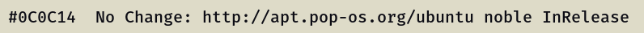
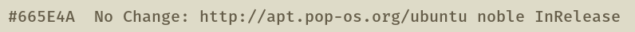
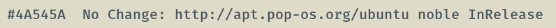
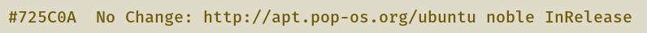
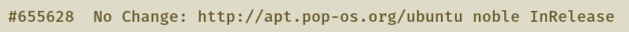
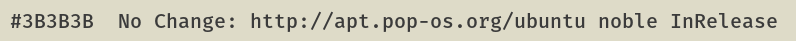

# COSMIC Terminal schemes

Colour schemes for COSMIC Terminal. The desktop `.ron` in `cosmic/` does not
colour ANSI text, so the terminal needs its own import.

1. COSMIC Terminal → **View → Color schemes…** (not Settings → Appearance)
2. **Light** tab → **Import** → a `.ron` from this folder
3. View → Settings → Appearance → Color scheme (light) → the scheme name

If a profile is set as default, set the scheme on that profile too or the
dropdown will look like it did nothing. `cosmic/install.sh` selects **White Gold**,
so import that one at least.

Every scheme here keeps the 16 ANSI colours of White Gold. Only the plain text
colour and the dim text change, so bat, lsd, starship, nala and btop look the
same whichever one you pick. The cursor stays dark gold  `#655628`.

The ANSI slots follow the rice: `red` is wine
 `#7A1F22`; `green` is olive
gold  `#725C0A`; `yellow` is
bronze  `#6C5319`; `blue` is
slate, the directory colour 
`#4A545A`; `magenta` is plum, the symlink colour
 `#6A3D5A`; `cyan` is
graphite  `#3B3B3B`; `white`
is muted  `#665E4A`.
Directories are not affected: `LS_COLORS` in `zsh/whitegold.zsh` colours them in
truecolor.

## Which one

Ink  `#0C0C14` is the default. The others move through White Gold's own greys
and tints: calmer above it, brighter below it, for whoever finds the default
glares at night or reads too dim by day.

| Scheme | Plain text | Contrast | Also used for |
|--------|------------|----------|---------------|
| White Gold Muted |  `#665E4A` | 4.6:1 | muted text, the dim text colour and the `white` slot |
| White Gold Slate |  `#4A545A` | 5.6:1 | directories (`LS_COLORS`), links, the `blue` slot |
| White Gold Olive |  `#725C0A` | 4.6:1 | success, the `green` slot |
| White Gold Gold |  `#655628` | 5.2:1 | the accent and the cursor |
| White Gold Graphite |  `#3B3B3B` | 8.0:1 | the `cyan` slot, a neutral a step from ink |
| **White Gold** (default) |  `#0C0C14` | 14.0:1 | the plain text colour of the rice |

When plain text shares a colour with an ANSI slot, output in that slot stops
standing out: directories in White Gold Slate, for example, look like plain text.
Errors and numbers stand out more against the dimmer schemes than against
ink.

**Bold:** `bright_foreground` ( `#000000`) only colours bold text when
`use_bright_bold` is on. The baseline config in `cosmic/config/` leaves it off,
so bold text is the plain text colour at weight 800.

Previews are rendered in Fira Mono on the terminal background  `#DEDBC8`, not
taken from the terminal. In COSMIC you get Maple Mono at 77% opacity over the wallpaper, so text looks a little softer and contrast a little lower.

## Light

**White Gold** · `WhiteGold-term.ron` · ink  `#0C0C14`, 14.0:1. The default.

**White Gold Muted** · `WhiteGold-term-muted.ron` ·  `#665E4A`, 4.6:1. Muted text, the dim text colour and the `white` slot.

**White Gold Slate** · `WhiteGold-term-slate.ron` ·  `#4A545A`, 5.6:1. Directories (`LS_COLORS`), links, the `blue` slot.

**White Gold Olive** · `WhiteGold-term-olive.ron` ·  `#725C0A`, 4.6:1. Success, the `green` slot.

**White Gold Gold** · `WhiteGold-term-gold.ron` ·  `#655628`, 5.2:1. The accent and the cursor.

**White Gold Graphite** · `WhiteGold-term-graphite.ron` ·  `#3B3B3B`, 8.0:1. The `cyan` slot, a neutral a step from ink.

Contrast is plain text on the terminal background, WCAG 2.
