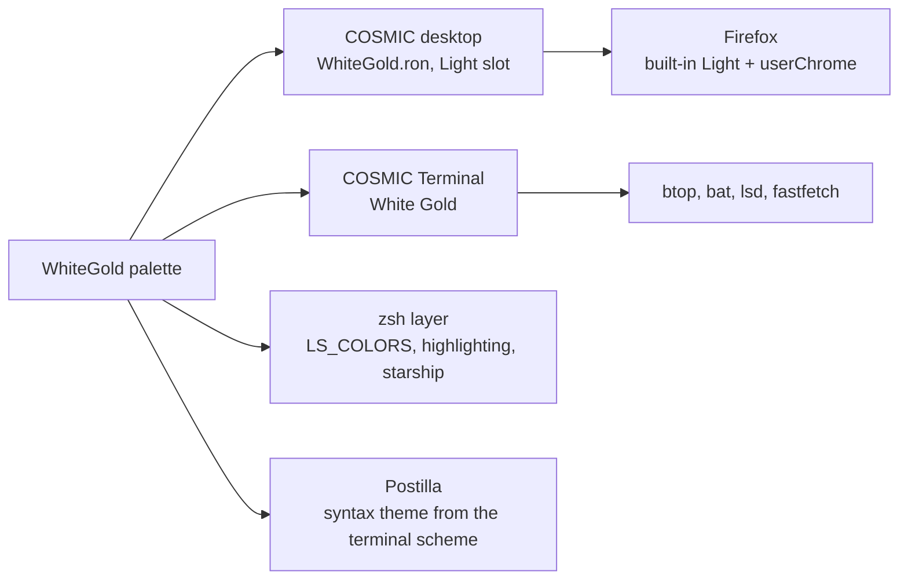

# WhiteGold

> Parchment and dark gold, the light sibling of DarkGold.

Pop!_OS 24.04 on the COSMIC desktop, one palette carried through the whole
machine: desktop, terminal, shell, editor, browser. This note is the rice
describing itself, written in Markdown and rendered by **Postilla**.

## Palette

Every text colour is checked against the window background `#DEDBC8`.

| Role | Hex | Contrast on background |
|------|-----|------------------------|
| Text | `#0C0C14` | 14.0:1 |
| Dark gold, accent | `#655628` | 5.2:1 |
| Olive gold, success | `#725C0A` | 4.6:1 |
| Bronze, warning | `#6C5319` | 5.2:1 |
| Wine, error | `#7A1F22` | 7.4:1 |
| Slate, directories | `#4A545A` | 5.6:1 |
| Plum, symlinks | `#6A3D5A` | 6.2:1 |

Containers sit one step away from the background at `#E9E6D3`, which is
what frosted glass blurs into.

## Where the colours go



## Setup, in order

- [x] Import `cosmic/WhiteGold.ron` into Appearance, **Light** slot
- [x] Import `cosmic-term/WhiteGold-term.ron`, pick **White Gold** for the profile
- [x] `./icons/install.sh` for the **Cosmic-WhiteGold** icons, `./cosmic/install.sh` for fonts and the terminal look
- [x] `./zsh/install.sh`, `./lsd/install.sh`, `./fastfetch/install.sh`
- [x] Cursor: Oxygen-17-Black
- [x] Wallpaper: `cool-wallpapers/cosmic/whitegold/whitegold-samurai`
- [x] Screenshot for the README

## The baseline every rice shares

```ron
corner_radii: (
    radius_xs: (2.0, 2.0, 2.0, 2.0),   // squared corners
    radius_xl: (2.0, 2.0, 2.0, 2.0),
),
frosted: VeryLow,
frosted_windows: true,
frosted_panel: true,
frosted_applets: true,
frosted_maximized_apps: false,
gaps: (0, 7),
active_hint: 1,
```

Contrast is the WCAG ratio[^1], where $L$ is relative luminance:

```typst
$ (L_1 + 0.05) / (L_2 + 0.05) >= 4.5 $
```

---

*Rendered in Postilla, a Markdown notes app for COSMIC. The window is painted
with this rice's terminal scheme, imported as a syntax theme.*

[^1]: Web Content Accessibility Guidelines, success criterion 1.4.3. Normal text wants 4.5:1, large text 3:1.
